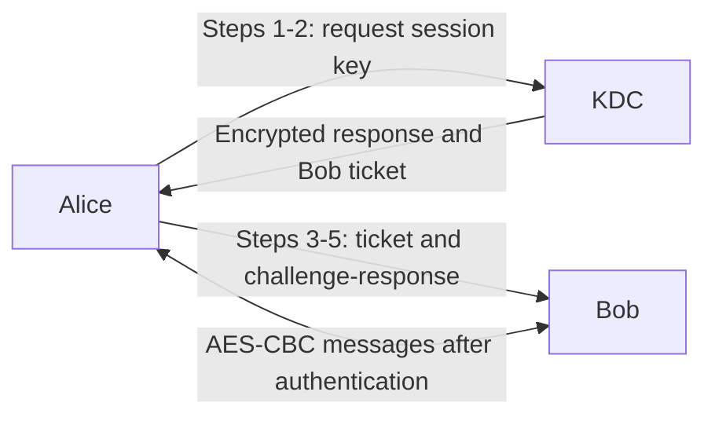

# KDC AES Manual

[](#requirements)
[](#protocol-overview)
[](#features)

Educational implementation of manual AES-128-CBC and a five-step Key
Distribution Center (KDC) protocol. The system has three roles—KDC, Alice, and
Bob—and supports bidirectional TCP messaging after authentication.

**Course:** Information Security, Assignment 2<br>
**Author:** Bara S. Rohmani (SID 5025241144)<br>
**Institution:** Department of Informatics Engineering, ITS Surabaya

> For learning and controlled demonstrations only. Do not use this project to
> protect real data.

## Contents

- [Assignment Status](#assignment-status)
- [Features](#features)
- [Additional Features](#additional-features)
- [Protocol Overview](#protocol-overview)
- [Requirements](#requirements)
- [Quick Start](#quick-start)
- [Testing](#testing)
- [Limitations](#limitations)
- [Documentation](#documentation)
- [References](#references)



Detailed messages and verification are shown in the [protocol sequence](docs/protocol-flow.md#protocol-flow-5-steps).

## Assignment Status

| Area | Status |
|---|---|
| Manual AES-128-CBC implementation and test vectors | Complete |
| KDC protocol, Alice/Bob clients, and localhost bidirectional tests | Complete; 82 automated tests recorded |
| Three-device test and Wireshark analysis | Not run; results are not claimed |

The assignment requires manual AES and KDC implementations, ASCII keys and
plaintext, hexadecimal ciphertext, changeable non-hardcoded keys, three
distinct device IP addresses, and two-way communication after step 5. The
current automated networking results use localhost; they do not prove the
three-device requirement. The original task brief is retained in
[`docs/assignment-detail.txt`](docs/assignment-detail.txt).

## Features

- Manual AES-128 block encryption/decryption, CBC mode, random 16-byte IVs,
  and PKCS#7 padding.
- Five-step KDC key distribution and challenge-response authentication.
- Alice and Bob exchange encrypted ASCII messages in both directions over TCP.
- Per-role JSON configuration keeps long-term keys out of source code and Git.
- Python standard library only; no external runtime dependencies.

### Additional Features

Beyond the assignment's core requirements, the implementation includes:

- Interactive key updates without restarting services, plus Alice's `/rekey`
  command to establish a fresh session.
- Line-delimited JSON framing with message-size limits and validation for
  malformed, incomplete, or out-of-order messages.
- Random nonces, stale KDC response checks, session-key masking in logs, and
  generic network errors for cryptographic authentication failures.
- Automated coverage for standard AES vectors, protocol validation,
  concurrent KDC requests, failure cases, and end-to-end two-way localhost
  communication.

## Protocol Overview

Alice requests a session key from the KDC, forwards Bob's encrypted ticket,
then answers Bob's nonce challenge. Once Bob verifies step 5, both parties can
exchange messages encrypted with the session key. Alice does not receive a
separate step-5 confirmation.

See [Protocol Flow](docs/protocol-flow.md) for message fields, validation, and
wire format, and [Architecture](docs/architecture.md) for roles, configuration,
network topology, and design decisions.

## Requirements

- Python 3.7 or newer.
- Standard library only.

No `requirements.txt` is needed because the project has no third-party
dependencies.

## Quick Start

From this directory, run the automated test suite:

```console
python -m unittest discover -s tests -v
```

For the AES command-line example:

```console
python aes.py "secret-key-is-16" "Hello Bob"
```

### Localhost Run

Copy each `config/<role>.example.json` to `config/<role>.json`. On a single
machine, use `127.0.0.1` for the KDC and Bob addresses. Set the same `K_A` in
`kdc.json` and `alice.json`, and the same distinct `K_B` in `kdc.json` and
`bob.json`. Each key must be exactly 16 ASCII characters. Replace all
`CHANGE_ME` values; real config files are ignored by Git.

Start each role in a separate terminal, from the project directory:

```console
python kdc.py --config config/kdc.json --mask-secrets
python bob.py --config config/bob.json --mask-secrets
python alice.py --config config/alice.json --mask-secrets
```

Alice starts the handshake automatically. In the Alice and Bob terminals, plain
text sends a message; commands begin with `/`.

| Role | Commands |
|---|---|
| Alice | `/send <text>`, `/rekey`, `/setkey <K_A>`, `/status`, `/help`, `/quit` |
| Bob | `/send <text>`, `/setkey <K_B>`, `/status`, `/help`, `/quit` |
| KDC | `ids`, `setkey <id> <key>`, `reload`, `help`, `quit` |

`--mask-secrets` hides `K_S` from application logs; it does not hide IDs,
nonces, addresses, or ciphertexts. Key updates are in-memory. To change a
long-term key, update the KDC and the corresponding client before starting a
new session.

## Testing

The test suite includes FIPS 197 AES vectors, NIST SP 800-38A CBC vectors,
protocol and configuration validation, TCP framing, KDC networking, and
end-to-end handshake and bidirectional-message tests. Recorded environments
and results are in [Test Results](docs/test-results.md). All recorded network
tests so far are localhost-only.

## Limitations

- CBC is not authenticated encryption; this protocol does not provide message
  integrity or reliable tamper detection.
- The ticket has no timestamp, and data messages have no sequence numbers;
  replay is not prevented.
- The AES implementation is not constant-time or side-channel resistant.
- The session-key alphabet provides about 104.6 bits of entropy.
- Network metadata and step-1 identities and nonce remain observable.

See [Architecture](docs/architecture.md) for the full list of design
limitations. The manual three-device and Wireshark procedures are in the
[Stage E guide](docs/stage-e-guide.md); neither has been completed yet.

## Documentation

| Document | Purpose |
|---|---|
| [`docs/assignment-detail.txt`](docs/assignment-detail.txt) | Original assignment brief |
| [`docs/architecture.md`](docs/architecture.md) | Roles, configuration, topology, decisions, limitations |
| [`docs/protocol-flow.md`](docs/protocol-flow.md) | Five-step protocol, wire format, validation |
| [`docs/test-results.md`](docs/test-results.md) | Recorded test results and pending Stage E evidence |
| [`docs/stage-e-guide.md`](docs/stage-e-guide.md) | Three-device test followed by Wireshark procedure |
| [`docs/security-review.md`](docs/security-review.md) | Final security review |

## References

- NIST, [FIPS 197: Advanced Encryption Standard (AES)](https://doi.org/10.6028/NIST.FIPS.197).
- NIST, [SP 800-38A: Recommendation for Block Cipher Modes of Operation](https://doi.org/10.6028/NIST.SP.800-38A).
