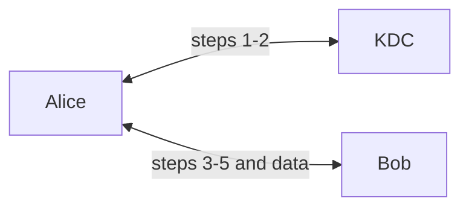
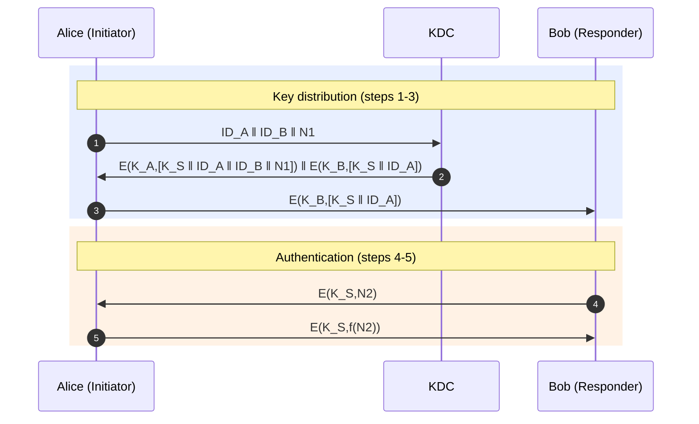

# KDC AES Manual

Manual AES-128 (CBC) with a five-step KDC key distribution protocol and two-way TCP communication between three entities: **KDC**, **Alice**, and **Bob**.

**Course:** Information Security (Keamanan Informasi) · Assignment 2<br>
**Author:** Bara S. Rohmani (SID 5025241144)<br>
**Institution:** Department of Informatics Engineering, ITS Surabaya, Indonesia

> Educational project, not for production use. See [Limitations](#limitations).

## Status

| Stage | Scope | Status |
|---|---|---|
| A | Architecture, protocol, message format (`docs/`) | Done |
| B | `aes.py` (AES-128, CBC, PKCS#7) and `tests/test_aes.py` | Done. 16/16 tests pass in the reference run ([results](docs/test-results.md)); re-verify on the target devices |
| C | `common.py`, `kdc.py`, config format, protocol and KDC tests | Done. 58 tests (whole suite) pass in the reference run; localhost only |
| D | `alice.py`, `bob.py`, two-way messaging | Not started |
| E | Three-device test, Wireshark analysis, demo guide | Not started |

## Architecture



| Entity | Holds | Role |
|---|---|---|
| KDC | `K_A`, `K_B` | Generates `K_S`; builds Alice's response and Bob's ticket |
| Alice | `K_A`, then `K_S` | Initiator: requests `K_S`, forwards the ticket, answers the challenge |
| Bob | `K_B`, then `K_S` | Responder: opens the ticket, issues the challenge, verifies the answer |

## Protocol

`E(K,X)` is AES-128-CBC encryption, `‖` is concatenation.



| # | Direction | Content |
|---|---|---|
| 1 | A → KDC | `ID_A ‖ ID_B ‖ N1` (plaintext) |
| 2 | KDC → A | `E(K_A,[K_S ‖ ID_A ‖ ID_B ‖ N1]) ‖ E(K_B,[K_S ‖ ID_A])` |
| 3 | A → B | `E(K_B,[K_S ‖ ID_A])` |
| 4 | B → A | `E(K_S,N2)` |
| 5 | A → B | `E(K_S,f(N2))`, where `f(N2) = (N2 + 1) mod 2^64` |

Verification rules, wire format, and failure handling: [`docs/protocol-flow.md`](docs/protocol-flow.md). Design decisions and topology: [`docs/architecture.md`](docs/architecture.md).

## Cryptography (implemented in `aes.py`)

| Item | Detail |
|---|---|
| Cipher | AES-128 written manually: key expansion, SubBytes, ShiftRows, MixColumns, AddRoundKey, and their inverses. The S-box is computed in GF(2^8) at import |
| Mode | CBC with a random 16-byte IV per encryption; output is `Hex(IV ‖ ciphertext)` |
| Padding | PKCS#7; always adds 1-16 bytes, so an empty message becomes one block |
| Input | Key: exactly 16 ASCII characters. Plaintext: ASCII. Anything else raises `AESError` |

Session key `K_S` (Stage C): 16 characters from 93 printable ASCII symbols (no `|`), generated by the KDC with `secrets`. Nonces are random 64-bit integers.

## Quick start

Requires Python 3.7+ and the standard library only (tested on 3.14.3).

```bash
python -m unittest discover -s tests -v
python aes.py "secret-key-is-16" "Hello Bob"
```

## Configuration

Copy each `config/<role>.example.json` to `config/<role>.json` (git-ignored) and replace the placeholder keys. Keys are exactly 16 ASCII characters and must differ per identity; values starting with `CHANGE_ME` are rejected. Field reference: [`docs/architecture.md`](docs/architecture.md).

## Running the KDC

```
python kdc.py --config config/kdc.json
```

Console commands: `ids`, `setkey <id> <key>`, `reload`, `help`, `quit`. Every request is logged by step, including the plaintext and the hex ciphertext. The session key is shown for demonstration; use `--mask-secrets` to hide it. Changing a key on the KDC does not change it on Alice or Bob.

## Project structure

```text
02-kdc-aes-manual/
├── aes.py                  # done
├── common.py               # done
├── kdc.py                  # done
├── alice.py                # planned (Stage D)
├── bob.py                  # planned (Stage D)
├── config/                 # planned: *.example.json only; real keys are git-ignored
├── tests/
│   ├── test_aes.py         # done
│   ├── test_protocol.py    # done
│   └── test_network.py     # KDC over localhost done; Alice/Bob planned
├── docs/
│   ├── architecture.md
│   ├── protocol-flow.md
│   └── test-results.md
├── .gitignore
└── README.md
```

## Testing

`tests/test_aes.py` covers:

- FIPS 197: key expansion (Appendix A), block encryption and decryption (Appendix B, C.1).
- NIST SP 800-38A: CBC-AES128 (first two blocks).
- Round-trip for many lengths, padding, random IV, wrong key, corrupted or truncated ciphertext, key-length validation, non-ASCII rejection, empty message.

`tests/test_protocol.py` covers the protocol logic of steps 1-3, framing, validation, and config; `tests/test_network.py` exercises the KDC over TCP on `127.0.0.1`. Tests for steps 3-5 and Alice/Bob will come with Stage D; three-device tests with Stage E. Recorded results: [`docs/test-results.md`](docs/test-results.md).

## Limitations

- CBC without a MAC gives no integrity or authentication. Tampering is only caught by padding and field checks.
- The ticket in step 3 has no timestamp, so the protocol does not prevent replay.
- The AES code is not constant-time and is not side-channel resistant.
- ASCII-only `K_S` (93 symbols, 16 characters) gives about 105 bits of entropy, not 128.
- Step 1 identities and `N1`, IP addresses, and message metadata are visible on the network.

## References

1. NIST. *FIPS 197: Advanced Encryption Standard (AES).* https://doi.org/10.6028/NIST.FIPS.197
2. NIST. *SP 800-38A: Recommendation for Block Cipher Modes of Operation.* https://doi.org/10.6028/NIST.SP.800-38A
