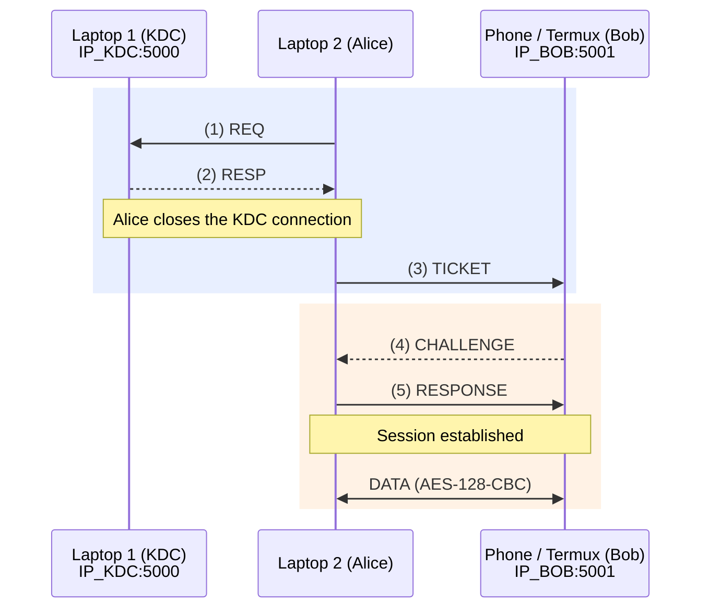

# Architecture

Status: **Design baseline; Stage E validation pending**. All components (`aes.py`, `common.py`, `kdc.py`, `alice.py`, `bob.py`) have been implemented and Stage D passed on localhost. Three-device network testing and Wireshark analysis have not yet been run.

## Goal

The system has three entities on three different IP addresses. The KDC distributes the session key `K_S` to Alice and Bob through a 5-step protocol. After that, Alice and Bob can communicate with each other in both directions using a manually implemented AES-128 algorithm.

## Technical Decisions

| Item | Decision |
|---|---|
| Language / UI | Python 3, CLI |
| AES | Manual AES-128 implementation, CBC mode, random 16-byte IV for each encryption, PKCS#7 padding |
| Data format | ASCII keys and plaintext; ciphertext in Hex (`IV ‖ C`) |
| Non-ASCII | Rejected with `AESError` |
| Transport | TCP, with one persistent Alice–Bob connection |
| Nonce | Random 64-bit integer (`secrets.randbits(64)`), sent as decimal ASCII |
| `f(N2)` | `N2 + 1 (mod 2^64)` |
| `K_S` | 16 characters from 93 symbols (ASCII 0x21-0x7E, excluding the backtick character (`` ` ``)) |
| Long-term keys | `K_A` and `K_B` are stored in local config files, not in the source code or Git |
| Libraries | `secrets`, `socket`, `json`, and `threading` are allowed. AES and the KDC protocol are implemented manually. |

## Network Topology (Stage E Target; Not Yet Validated)

- Alice opens two TCP connections: one to the KDC for steps 1–2, which is then closed, and another to Bob for steps 3–5 and subsequent data communication.
- Bob never connects to the KDC directly.
- Device setup: Bob runs on a phone using Termux. The laptop provides the Wi-Fi hotspot, not the phone.
- Use the actual private LAN IP addresses assigned to the KDC laptop and Bob
  phone in Alice's config. The values in the example configs are illustrative,
  not assigned addresses.
- The target ports are TCP 5000 for the KDC and TCP 5001 for Bob. Both
  listeners bind to `0.0.0.0`; allow inbound traffic only on the trusted local
  network when the host firewall requires a rule.
- Before testing, verify the hotspot permits communication between clients.
  The three-device topology remains unverified until the manual Stage E test
  passes. See [`stage-e-guide.md`](stage-e-guide.md) for the ordered procedure.

## Key Ownership

| Entity | Knows | Must not know |
|---|---|---|
| KDC | `K_A`, `K_B`, and generates `K_S` | — |
| Alice | `K_A` and `K_S` (after step 2) | `K_B` |
| Bob | `K_B` and `K_S` (after step 3) | `K_A` |

## State Machine

- **Bob:** `IDLE → GOT_TICKET → ESTABLISHED`
- **Alice:** `INIT → HAVE_KS → AUTHENTICATED`

`DATA` messages are accepted and sent only when Bob is in the `ESTABLISHED` state or Alice is in the `AUTHENTICATED` state. Messages received in other states are rejected.

## File Structure

- `aes.py` (B)
- `common.py`, `kdc.py`, `config/*.example.json` (C)
- `alice.py`, `bob.py` (D)
- `tests/` — Test files.
- `docs/` — Documentation.

## Known Limitations (Intentional)

1. **Ticket replay:** The ticket sent in step 3 has no timestamp, so it can be replayed.

2. **No MAC:** CBC does not provide data integrity. An attacker could modify the ciphertext using a bit-flipping attack. Such modifications may be detected through padding checks and field validation, but these checks do not guarantee integrity. Adding a MAC is a separate topic and does not change the 5-step protocol.

3. **Session key entropy:** `K_S` has approximately 104.6 bits of entropy (`93^16` possible combinations), rather than the full 128 bits, because the key must use ASCII characters.

4. **AES is not constant-time:** The implementation is not protected against side-channel attacks. It is intended for learning purposes only.

5. **Limited network confidentiality:** Some information remains visible in Wireshark, including IDs, the step 1 nonce, IP addresses, and JSON metadata.

## Configuration (Stage C)

The local file `config/<role>.json` is created by copying `config/<role>.example.json`. Local files are excluded from Git. Fields prefixed with `_` (e.g., `_comment`) are ignored; other unknown fields are rejected to detect typos.

| Role | Fields (required *) | Defaults |
|---|---|---|
| `kdc` | `keys`* = `{id: key}` with at least 2 identities; `host`; `port` | host `0.0.0.0`, port `5000` |
| `alice` | `id`*, `key`* (= K_A), `kdc`* = `{host*, port}`, `peer`* = `{id*, host*, port}` | kdc.port `5000`, peer.port `5001` |
| `bob` | `id`*, `key`* (= K_B), `host`; `port` | host `0.0.0.0`, port `5001` |

**Rules:** Keys must be exactly 16 ASCII characters; each identity in the KDC must have a unique key; values beginning with `CHANGE_ME` are rejected; IDs must match `[A-Za-z0-9_]` and be 1–32 characters long; error messages must not contain key values. Host values in the example files are illustrative only.

## Design Decisions (Stage D)

| Item | Decision | Consequence |
|---|---|---|
| Step 5 confirmation | Bob does not send a confirmation message; the protocol remains exactly 5 steps. | Alice considers the session `AUTHENTICATED` after sending Step 5. If Bob rejects it, an `ERROR` message arrives and the session is closed. Bob always verifies Step 5 before reading any `DATA`. |
| Errors sent over the network | Cryptographic failures (wrong key, corrupted ticket, incorrect nonce) receive only the response `authentication failed`; details are recorded only in local logs. | Prevents CBC padding oracles caused by different error messages. Differences in response timing are not addressed. |
| Bob's session | Only one active session is allowed. A new connection replaces the old session **only after Step 5 succeeds**. | Alice's `/rekey` command is not blocked, and an unauthenticated connection cannot evict the active session. |
| Messages sent to Bob before the ticket | `DATA` or `RESPONSE` before `TICKET`, or `DATA` before `RESPONSE`, are rejected and the connection is closed. | Enforces the requirement to reject communication until Step 5 succeeds. |
| Changing keys at runtime | `/setkey` in Alice/Bob and `setkey` in the KDC modify in-memory values only. Alice's session is closed when `K_A` changes. | Keys must be changed on both endpoints (and in the KDC) before `/rekey` is used. |
| Alice's ID at Bob | Bob accepts any ID included in a valid ticket; only the KDC knows `K_B`. | Bob does not maintain an ID allowlist. |
| Reflection attack | Alice responds with `f(N2) = N2 + 1`; returning `E(K_S, N2)` unchanged is rejected. | This is why `f(N2)` must differ from `N2`. |

Additional limitations: Ticket replay by an entity that also knows the old `K_S` is not prevented because there is no timestamp. `DATA` messages have no sequence numbers, so a valid message can be replayed within the same session.