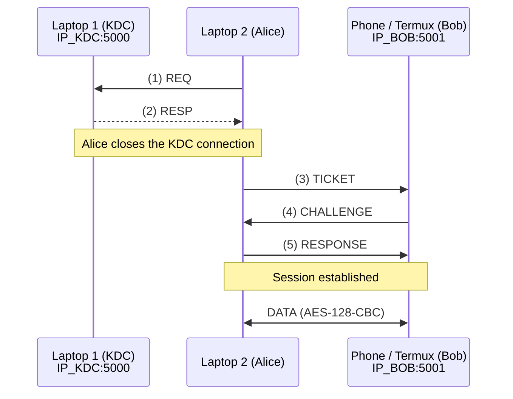

# Architecture

Status: **Stage A design** (`aes.py` with AES has been implemented in Stage B; networking and the KDC are not implemented yet).

## Goal

The system has three entities on three different IP addresses. The KDC distributes a session key `K_S` to Alice and Bob through a 5-step protocol. After that, Alice and Bob can communicate with each other in both directions using a manually implemented AES-128 algorithm.

## Technical Decisions

| Item | Decision |
|---|---|
| Language / UI | Python 3, CLI |
| AES | Manual AES-128 implementation, CBC mode, random 16-byte IV for each encryption, PKCS#7 padding |
| Data format | ASCII keys and plaintext; ciphertext in Hex (`IV ‖ C`) |
| Non-ASCII | Rejected with `AESError` |
| Transport | TCP, with one persistent Alice–Bob connection |
| Nonce | Random 64-bit integer (`secrets.randbits(64)`), sent as decimal ASCII |
| `f(N2)` | `N2 + 1 (mod 2^64)` |
| `K_S` | 16 ASCII characters selected from 94 printable characters, excluding the backtick character (`) |
| Long-term keys | `K_A` and `K_B` are stored in local config files, not in the source code or Git |
| Libraries | `secrets`, `socket`, `json`, and `threading` are allowed. AES and the KDC protocol are implemented manually. |

## Network Topology (Planned)

- Alice opens two TCP connections: one to the KDC for steps 1–2, which is then closed, and another to Bob for steps 3–5 and subsequent data communication.
- Bob never connects to the KDC directly.
- Device setup: Bob runs on a phone using Termux. The laptop provides the Wi-Fi hotspot, not the phone.
- The final IP addresses and port numbers will be decided in Stage E.

## Key Ownership

| Entity | Knows | Must not know |
|---|---|---|
| KDC | `K_A`, `K_B`, and generates `K_S` | — |
| Alice | `K_A` and `K_S` (after step 2) | `K_B` |
| Bob | `K_B` and `K_S` (after step 3) | `K_A` |

## State Machine

- **Bob:** `IDLE → GOT_TICKET → ESTABLISHED`
- **Alice:** `INIT → HAVE_KS → AUTHENTICATED`

`DATA` messages are accepted and sent only when Bob is in the `ESTABLISHED` state or Alice is in the `AUTHENTICATED` state. Messages received in other states are rejected.

## File Structure

- `aes.py` — Stage B, completed.
- `common.py`, `kdc.py`, `alice.py`, `bob.py`, `config/*.example.json` — Stages C–D, not created yet.
- `tests/` — Test files.
- `docs/` — Documentation.

## Known Limitations (Intentional)

1. **Ticket replay:** The ticket sent in step 3 has no timestamp, so it can be replayed.

2. **No MAC:** CBC does not provide data integrity. An attacker could modify the ciphertext using a bit-flipping attack. Such modifications may be detected through padding checks and field validation, but these checks do not guarantee integrity. Adding a MAC is a separate topic and does not change the 5-step protocol.

3. **Session key entropy:** `K_S` has approximately 105 bits of entropy (`94^16` possible combinations), rather than the full 128 bits, because the key must use ASCII characters.

4. **AES is not constant-time:** The implementation is not protected against side-channel attacks. It is intended for learning purposes only.

5. **Limited network confidentiality:** Some information remains visible in Wireshark, including IDs, the step 1 nonce, IP addresses, and JSON metadata.
