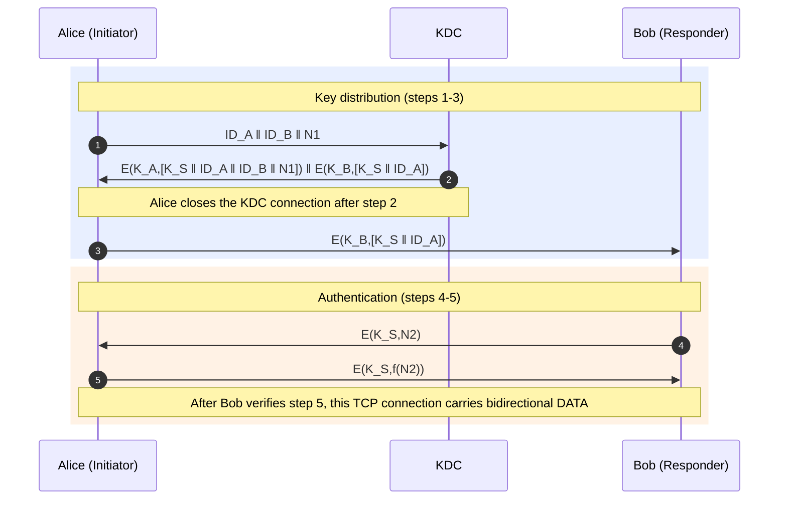

# Information Security Assignment 2

**Course:** Information Security (KI)  
**Duration:** 2 weeks  
**Deadline:** October 27, 2026, at 23:59 WIB

## Assignment Requirements

### 1. Team Formation
- Individual or group submissions are allowed.
- Each group may consist of a maximum of **2 members**.

### 2. Architecture and Key Distribution
- Implement the **Key Distribution Scenario** involving three entities: KDC, Alice, and Bob.
- Each entity must use a different IP address.
- After step 5 of the scenario, Alice and Bob must be able to communicate using AES.

### 3. Bidirectional Communication
- Alice and Bob must both be able to act as sender and receiver.
- The communication architecture is flexible: client-server or client-client.
- Bidirectional communication must work between devices with different IP addresses.

### 4. AES Implementation and Data Formats
- Keys and plaintext must use **ASCII** format.
- Ciphertext must be displayed in **hexadecimal (Hex)** format.
- **AES and KDC must be implemented manually.**
- The key must be configurable; hardcoding it is discouraged.

### 5. Program Interactivity
- An interactive program is recommended to facilitate testing with various test cases during the demo.
- The key should be changeable without restarting the program.

### 6. Wireshark Preparation
- Prepare Wireshark before the demo.
- Ensure the correct network interface is selected, filters are configured, and data transmissions can be clearly observed.

### 7. Code Preparation and Understanding
- Ensure the program runs correctly before the demo.
- Every member must understand the AES implementation, KDC, and the overall architecture.
- During the demo, explanations must be delivered without reading notes or code comments.
- Excessive comments resembling personal notes may reduce the score.

### 8. Group Registration
Register each KI group in the following spreadsheet no later than **Sunday, October 18, 2026**.

### 9. Submission
- Submit the assignment through Google Forms no later than **Tuesday, October 27, 2026, at 23:59 WIB**.
- Submit the link to the GitHub repository.
- For group assignments, one representative must submit on behalf of the group.
- Authorship must accurately reflect the actual contributors, with only the two group members' accounts represented.
- Commit history will be considered during evaluation.

### 10. Demo and Evaluation
- Demos are conducted **individually**, including for group members.
- Evaluation covers each member's understanding and contribution.
- Knowledge of AES, KDC, and the overall architecture will be assessed.
- **Demo rescheduling is not allowed except under genuinely unavoidable circumstances.**
- The demo schedule will be announced later.

### 11. Plagiarism
Plagiarism is strictly prohibited. Anyone found guilty of plagiarism will receive a score of **0**.

### 12. Additional Features
Implementing additional features beyond the stated requirements may earn extra credit if they can be explained properly.

---

## Key Distribution Scenario

Please review all requirements carefully and make effective use of the allotted time.

Thank you.