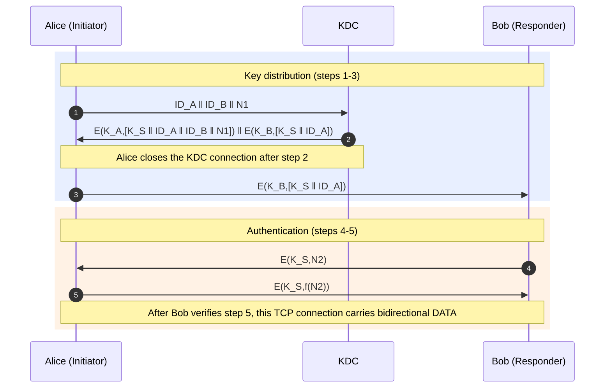

# Protocol Flow (5 Steps)

**Status:** All five steps and bidirectional communication are implemented
(`common.py`, `kdc.py`, `alice.py`, `bob.py`). Automated and manual Stage D
tests ran on localhost; the three-device Stage E test is pending. See the
[Stage E guide](stage-e-guide.md) before Wireshark analysis.



Notation: `ID_A`, `ID_B` = identities; `N1`, `N2` = nonces; `K_A`, `K_B` =
long-term keys; `K_S` = session key; `E(K,X)` = AES-128-CBC encryption,
output as hexadecimal `IV ‖ C`; `f(N2) = N2 + 1`.

| # | Direction | Logical contents | Encrypted | Receiver validation |
|---|---|---|---|---|
| 1 | A → KDC | `ID_A ‖ ID_B ‖ N1` | No | KDC: both IDs must be registered |
| 2 | KDC → A | `E(K_A,[K_S‖ID_A‖ID_B‖N1]) ‖ E(K_B,[K_S‖ID_A])` | Yes | Alice: decrypt with `K_A`; verify `ID_A`, `ID_B`, and `N1`; forward the ticket without opening it |
| 3 | A → B | `E(K_B,[K_S‖ID_A])` | Yes | Bob: decrypt with `K_B`; verify the format and `ID_A` |
| 4 | B → A | `E(K_S,N2)` | Yes | Alice: decrypt with `K_S`; verify that `N2` is numeric |
| 5 | A → B | `E(K_S,f(N2))` | Yes | Bob: verify that the value equals `N2 + 1` |

After Bob verifies step 5, Alice and Bob can communicate in both directions
using `E(K_S, message)`. Alice does not receive a separate step-5
confirmation.

## Serialization of Encrypted Contents

Fields are joined with `|` before encryption. For example:
`K_S|ID_A|ID_B|N1`.

- IDs only contain characters from `[A-Za-z0-9_]` and must be 1-32 characters
  long.
- Nonces only contain ASCII digits, with a maximum of 20 digits and a value
  less than 2<sup>64</sup>.
- `K_S` does not contain `|`.

These constraints make parsing unambiguous.

## KDC Rules (Implemented)

- `ID_A` and `ID_B` must be registered and distinct. Invalid IDs or `N1`
  values are rejected with an ERROR response.
- `K_S` is generated using `secrets.choice` from an alphabet of 93 symbols and
  must not match any long-term key.
- Each message is limited to 64 KiB.
- Each KDC connection handles one `REQ` message and is then closed.

## Wire Format

Each message is one JSON line ending with `\n`. Encrypted fields contain
hexadecimal `IV ‖ C`.

```json
1: {"type":"REQ","ida":"alice","idb":"bob","n1":"<decimal>"}
2: {"type":"RESP","part_a":"<hex>","ticket":"<hex>"}
3: {"type":"TICKET","ticket":"<hex>"}
4: {"type":"CHALLENGE","data":"<hex>"}
5: {"type":"RESPONSE","data":"<hex>"}
D: {"type":"DATA","data":"<hex>"}
E: {"type":"ERROR","reason":"..."}
```

## Failure Handling

Decrypting with the wrong key or using corrupted data raises `AESError` if the
padding is invalid, the decrypted data is not ASCII, or the data length is
incorrect.

If padding happens to be valid by chance (approximately 1 in 256), field
validation, such as checking the ID or nonce, can still reject the data.

If a nonce does not match, authentication fails and the connection is closed.

## Rules for Steps 3–5 and Data (Implemented)

- Bob rejects the first message if it is not `TICKET`, and rejects the second
  message if it is not `RESPONSE`. In either case, the connection is closed.
- A new 64-bit `N2` is generated for each connection. The only valid response
  is `E(K_S, N2+1 mod 2^64)`. `E(K_S,N2)` (reflection), `N2+2`, non-numeric
  text, or encryption with a different key is rejected.
- Cryptographic failures receive `{"type":"ERROR","reason":"authentication failed"}`
  over the network. Further details are recorded only in local logs.
- `DATA` plaintext must be ASCII; empty plaintext is allowed. Messages use
  `E(K_S, text)` with a new random IV and hexadecimal encoding. Non-ASCII text
  is rejected before sending. If a `DATA` message fails to decrypt, the
  failure is logged and the message is ignored; the session remains active.
- Bob does not send a confirmation for step 5. See the design decisions in
  [Architecture](architecture.md).
